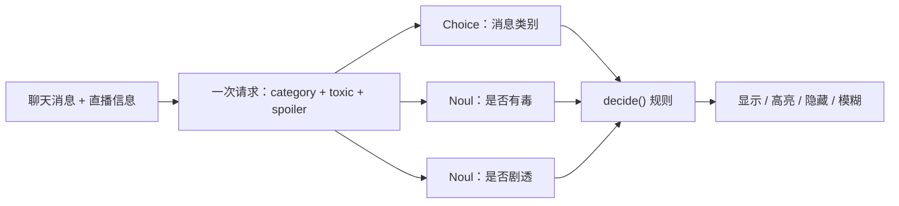

# Twitch 聊天过滤器

> 隐藏侮辱、垃圾信息和未经请求的游戏提示，模糊剧透，高亮问题。每条消息一次 TypeSafe 请求，内含多个问题。最多并行处理八条消息，规则在代码中定义。

## 问题

Twitch 直播聊天刷得比人眼快。这份食谱对每条到达的消息分类：问题高亮，垃圾、侮辱和未经请求的玩法提示隐藏，剧透模糊。关键词表能抓住垃圾链接，但「Go left, there's a treasure box behind the tree」没有脏话，剧情转折也没有。

每条消息单独发一次请求给 Jev，带上直播标题和游戏。问三个问题：这是什么类型的消息、是否有毒（侮辱、仇恨或骚扰）、是否剧透游戏。普通代码再把答案转成观众看到的内容。

用 29 条示例聊天消息演示：7 条隐藏，2 条模糊，6 条作为问题高亮。

## 架构

状态是直播信息加一条消息。一次请求同时问三个问题：

- `category`：Choice，五个类别（question / hype / conversation / backseat / spam），决定显示、高亮或隐藏。
- `toxic`：Noul，概率 ≥ 0.7 则隐藏（无论类别）。
- `spoiler`：Noul，概率 ≥ 0.7 则模糊（除非已隐藏）。

`classify()` 建状态并发请求，结果按状态+问题 JSON 缓存。`decide()` 只读答案、不发请求，按规则出动作。消息之间无依赖，用线程池最多 8 个并发，保持聊天顺序。



## 结论

29 条消息全部处理完毕。阈值 0.7 在示例上干净：toxic 要么 ≥0.97 要么 ≤0.24，spoiler 要么 ≥0.94 要么 ≤0.20。真实频道聊天会落在中间，上线前用自己的数据调阈值。

| 动作 | 条数 |
| --- | --- |
| show | 14 |
| highlight | 6 |
| hide (backseat) | 3 |
| hide (spam) | 2 |
| blur (spoiler) | 2 |
| hide (toxic) | 2 |

整个过滤器就是 `QUESTIONS`、`classify()` 和 `decide()`。换自己的 `STREAM` 和 `CHAT` 即可跑。规则改动不需要重新请求：答案描述消息，`decide()` 决定动作。

## 关键代码

三个问题在同一次请求里回答。

```python
QUESTIONS = {
    "category": Choice(
        instructions="Which category best describes the main purpose of `message.text`?",
        criteria={
            "question": "A genuine request for information from the streamer or chat, not gameplay instructions phrased as a question or a promotional pitch",
            "hype": "Cheering, reactions, or repeated emotes (PogChamp, LUL, GG, W, lets gooo); repetition alone does not make cheering spam",
            "conversation": "Ordinary chatter, opinions, replies, useful shared links, or any message whose main purpose does not fit the other categories",
            "backseat": "Unrequested gameplay advice telling the streamer what to do, including instructions phrased as a question; not a request for information",
            "spam": "Unsolicited advertising, self-promotion, follower selling, or promotional links; not ordinary cheering, repeated emotes, or a useful link",
        },
    ),
    "toxic": Noul(
        instructions="Is this message insulting, hateful or harassing towards someone?",
        criteria=NoulCriteria(
            true="Insults, slurs, threats or personal attacks on the streamer or another viewer",
            false="Friendly, neutral, or light banter with no target",
        ),
    ),
    "spoiler": Noul(
        instructions="Does this message reveal a plot point or ending of the game being played?"
    ),
}
```

决定动作只读答案。

```python
RULES = {
    "question": "highlight",
    "hype": "show",
    "conversation": "show",
    "backseat": "hide",
    "spam": "hide",
}
TOXIC_AT = 0.7
SPOILER_AT = 0.7

def decide(result: dict, rules: dict = RULES) -> str:
    if result["toxic"] >= TOXIC_AT:
        return "hide (toxic)"
    action = rules[result["category"]]
    if action == "hide":
        return f"hide ({result['category']})"
    if result["spoiler"] >= SPOILER_AT:
        return "blur (spoiler)"
    return action
```

完整实验与数据见官网原文：[Twitch chat filter](https://docs.typesafe.ai/cookbooks/twitch_chat_filter)
